# DAD-NNN-Inesa

**inesa hakobyan**

# JOUR 1 — 23.11.2026

## Point de départ

*« Chaque fois que l'on se souvient d'un souvenir, on se souvient d'un souvenir. »*

### Réflexion initiale

Réflexion sur la manière dont les souvenirs sont altérés et sur les raisons de ces altérations.

**Biais cognitifs liés à la mémoire**

Contrairement à un enregistrement vidéo fidèle, nos souvenirs sont souvent altérés, réorganisés et reconstruits, parfois sans que nous en ayons conscience.

### Sujet personnel

Mon sujet personnel est la nostalgie et la distorsion / déformation des souvenirs.

Je souhaite explorer la manière dont notre mémoire transforme le passé, comment les souvenirs évoluent avec le temps et pourquoi notre perception de certains événements change.

## Première idée de projet

Le projet prendrait place dans un espace numérique en 2D ou en 3D, dans lequel le joueur pourrait se déplacer et interagir avec différents objets.

### Mécanique de recadrage

La fonction de recadrage permettrait de sauvegarder des fragments de l'environnement considérés comme importants, intéressants ou mémorables.

À l'intérieur du cadre, le fragment serait déformé. Cette légère distorsion serait conservée même après sa sauvegarde.

L'objectif final serait de constituer une collection de souvenirs déformés.

## Métaphore visuelle — Kaléidoscope

Les fragments se reflètent, se répètent et se multiplient de façon asymétrique.

Un objet ordinaire peut ainsi se métamorphoser en une composition totalement différente.

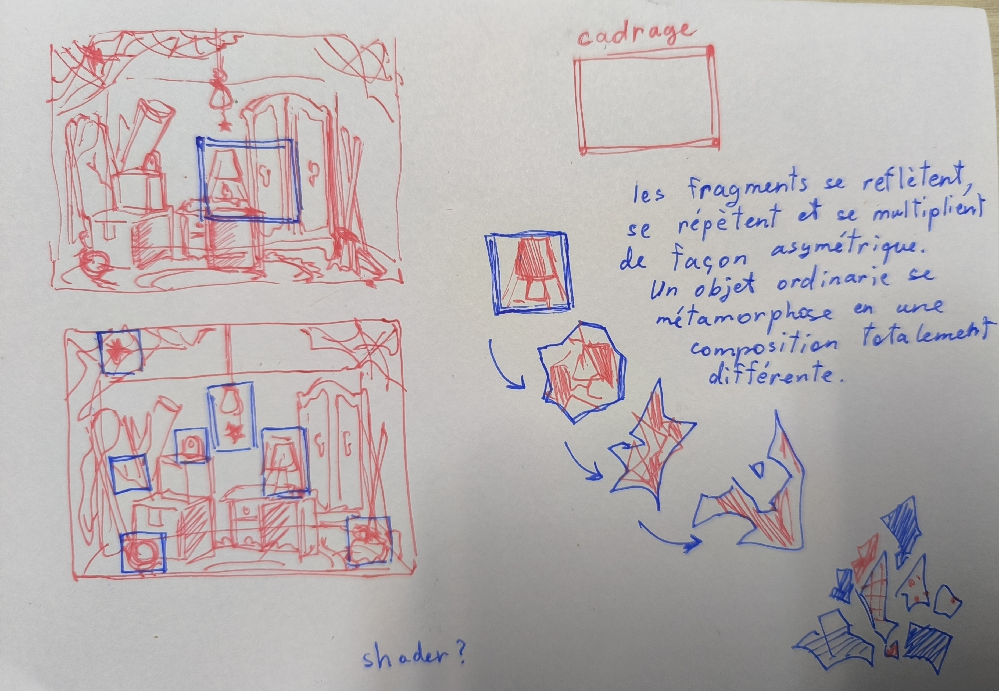

# JOUR 2 — 24.11.2026

On laisse souvent derrière soi des objets chargés de souvenirs, une sorte de base d'informations que seul celui qui les a vécus peut déchiffrer avec précision. Mais le temps déforme nos souvenirs ; alors, que se passe-t-il lorsqu'on tente de les reconstituer le plus fidèlement possible : sans filtre, sans idéalisation ?

>Contrairement à un enregistrement vidéo fidèle, nos souvenirs sont souvent altérés, réorganisés, reconstruits – parfois à notre insu.

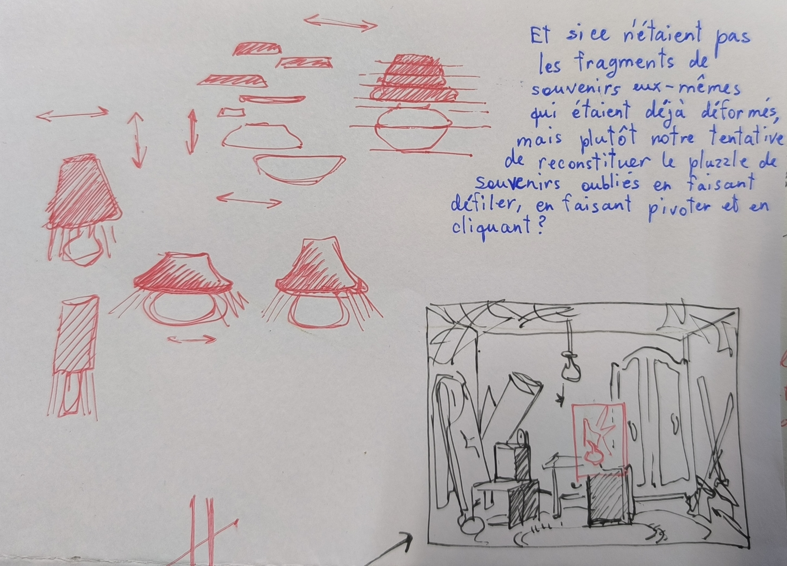

Et si ce n'étaient pas les fragments de souvenirs eux-mêmes qui étaient déjà déformés, mais plutôt notre tentative de reconstituer le puzzle de souvenirs oubliés en faisant défiler, en faisant pivoter et en cliquant ? Et nous recevrions des informations différentes selon la manière dont nous reconstituons le fragment de mémoire.

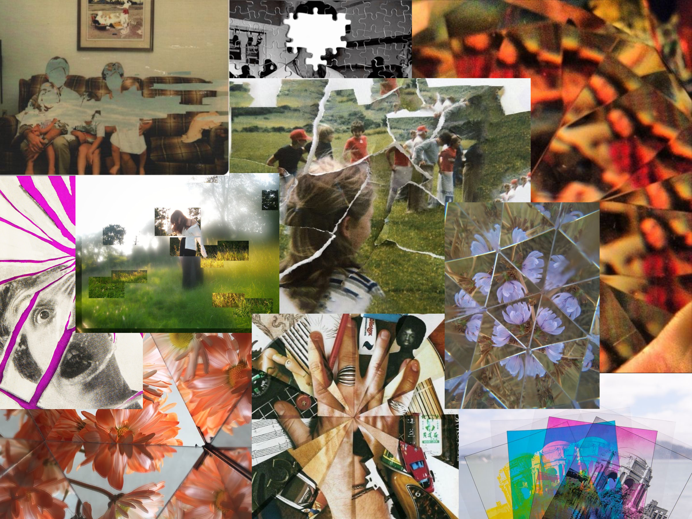

# JOUR 3 — 25.11.2026

## Recherche sur le thème de la nostalgie, de la mémoire, de nos sentiments envers le passé : pertinence, influence, conséquences

### 1. La nostalgie : un sentiment universel

La nostalgie est un sentiment complexe qui associe le bonheur lié aux souvenirs et la mélancolie de ne plus pouvoir revivre certains moments. Elle nous permet de conserver un lien émotionnel avec notre passé et participe à la construction de notre identité.

Cependant, la mémoire n'est pas une reproduction exacte de ce que nous avons vécu. Avec le temps, certains souvenirs disparaissent, d'autres se transforment et peuvent être idéalisés. Nous ne sommes donc pas toujours nostalgiques du passé réel, mais parfois de la manière dont nous nous le représentons.

### 2. Pourquoi la nostalgie revient-elle aujourd'hui ?

Dans un monde marqué par des changements rapides, l'incertitude et une présence constante des technologies, le passé peut devenir une source de réconfort et de stabilité.

Les anciennes technologies, les jouets, les jeux vidéo, la musique et les références culturelles des années 1980, 1990 et 2000 connaissent un nouvel intérêt. Ce phénomène concerne également les jeunes générations, qui peuvent ressentir de la nostalgie pour des époques qu'elles n'ont jamais connues.

La nostalgie devient alors un moyen de rechercher des repères familiers, mais aussi de construire une identité à travers des références culturelles.

### 3. La nostalgie comme stratégie commerciale

Les grandes entreprises ont compris que les souvenirs représentent un puissant outil marketing. En réutilisant des personnages, des produits et des univers familiers, elles créent un lien émotionnel avec les consommateurs.

Cette stratégie réduit le sentiment de risque lié à l'achat : un produit déjà connu inspire confiance et réactive des émotions positives.

Plusieurs exemples illustrent cette tendance :
- Disney multiplie les remakes et les suites de ses anciens films, comme Le Roi Lion ou La Belle et la Bête.
- Coca-Cola utilise son histoire et ses anciennes campagnes publicitaires pour renforcer son identité de marque.
- Nintendo et Pokémon réintroduisent régulièrement des univers et des jeux qui rappellent l'enfance de plusieurs générations.

La nostalgie permet ainsi de transformer des souvenirs collectifs en produits commerciaux.

### 4. Le passé comme objet de consommation

Le phénomène se retrouve également dans le marché des objets vintage et des collections : anciennes consoles, cartes Pokémon, jouets, vinyles ou vêtements rétro.

Ces objets possèdent une valeur qui dépasse leur fonction initiale. Ils deviennent des supports de mémoire, associés à des expériences personnelles et à des émotions.

Les entreprises et les marchés exploitent cette dimension sentimentale pour donner une nouvelle valeur à des objets anciens.

### 5. Une mémoire parfois idéalisée

La nostalgie commerciale propose souvent une vision embellie du passé. Les difficultés et les aspects négatifs d'une époque disparaissent au profit d'une représentation plus rassurante.

Les réseaux sociaux participent à cette reconstruction en diffusant des esthétiques rétro et des références à des périodes parfois inconnues des personnes qui les apprécient.

Cela soulève une question importante : sommes-nous nostalgiques de ce que nous avons réellement vécu ou d'une image idéalisée du passé ?

#
La nostalgie nous invite finalement à réfléchir à notre rapport à la mémoire : pourquoi cherchons-nous à conserver le passé, et pourquoi avons-nous parfois besoin de le reconstruire pour mieux vivre le présent ?

## Sources et références

1. [Sciences Humaines — Nostalgie : le retour en force](https://www.scienceshumaines.com/nostalgie-le-retour-en-force)

2. [NO COM — La stratégie de la nostalgie : pourquoi ça marche](https://www.nocom.com/storymania/culture-loisirs-la-strategie-de-la-nostalgie-pourquoi-ca-marche/)

3. [AdIndex — Nostalgie et marketing](https://adindex.ru/publication/opinion/marketing/2019/08/12/274425.phtml)

4. [RFI — Business : nostalgie, le passé est un marché extrêmement rentable](https://www.rfi.fr/fr/podcasts/aujourd-hui-l-%C3%A9conomie/20260807-business-nostalgie-passe-marche-extremement-rentable)

5. [BLING — Business Nostalgie](https://www.bling.eu/media/business-nostalgie/)

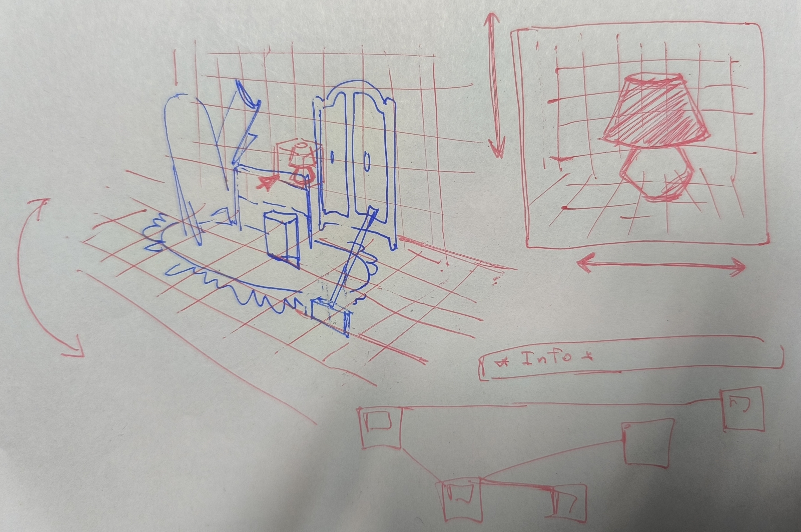

# JOUR 4 — 27.11.2026

préparation des concept art

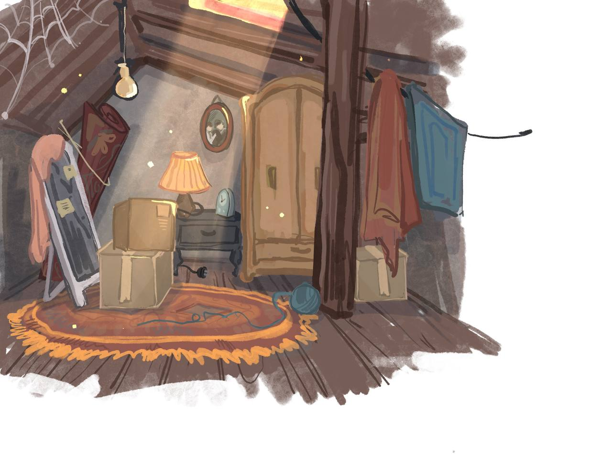
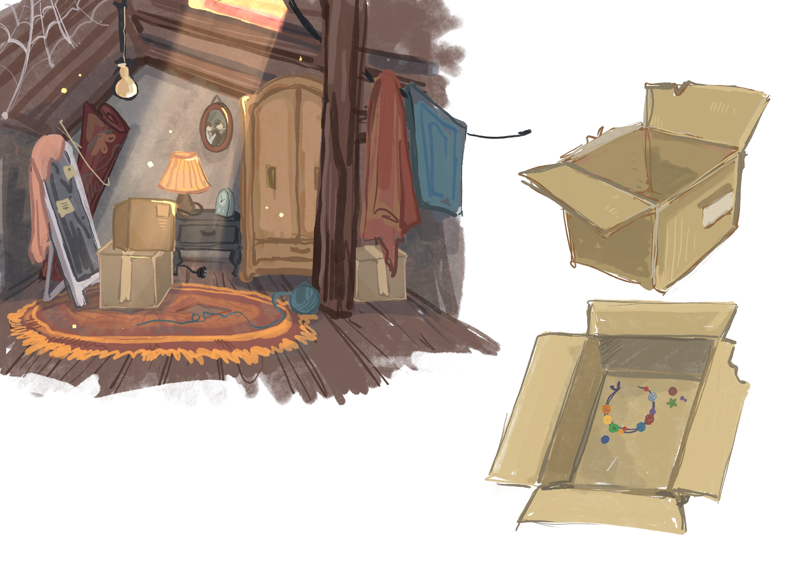
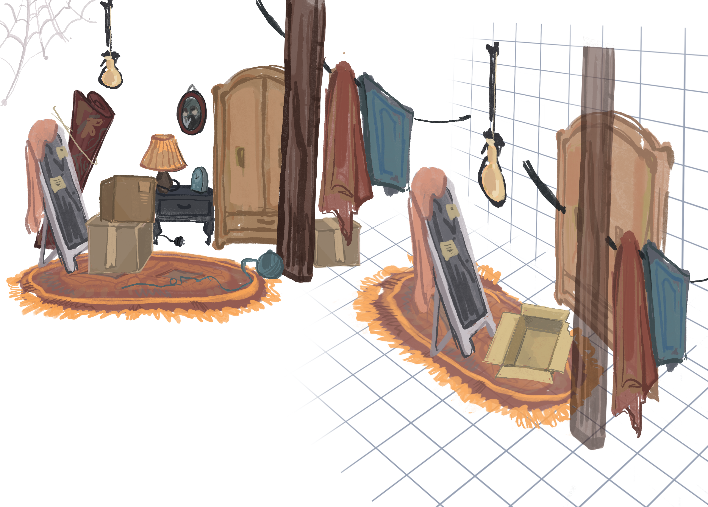

La mémoire n'est pas un enregistrement exact des événements. Elle est reconstruite à chaque fois que nous nous en souvenons.

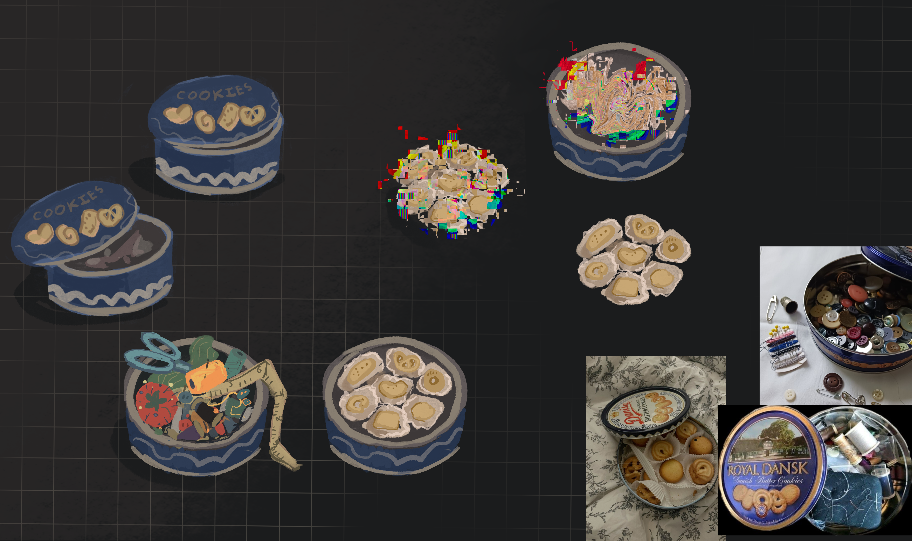
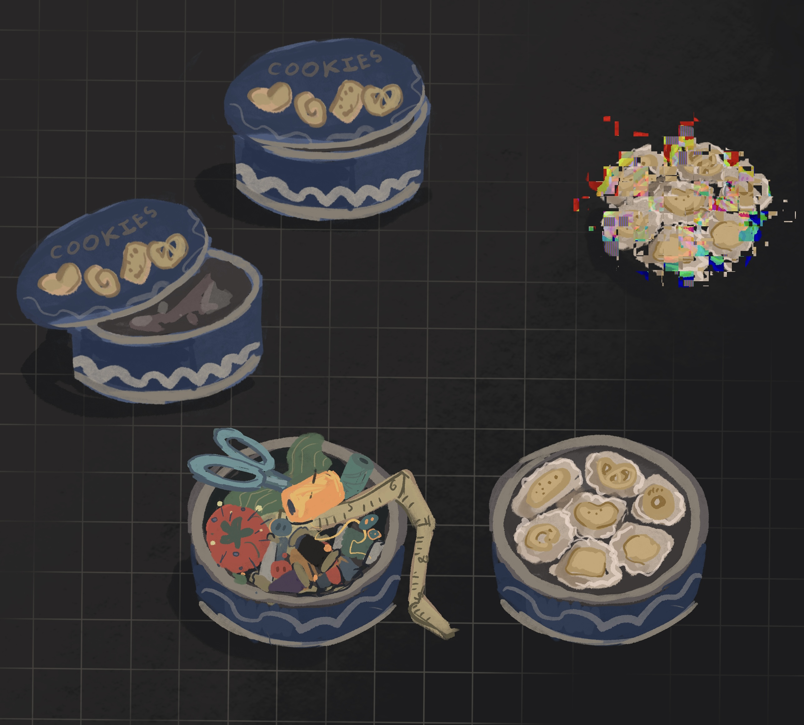
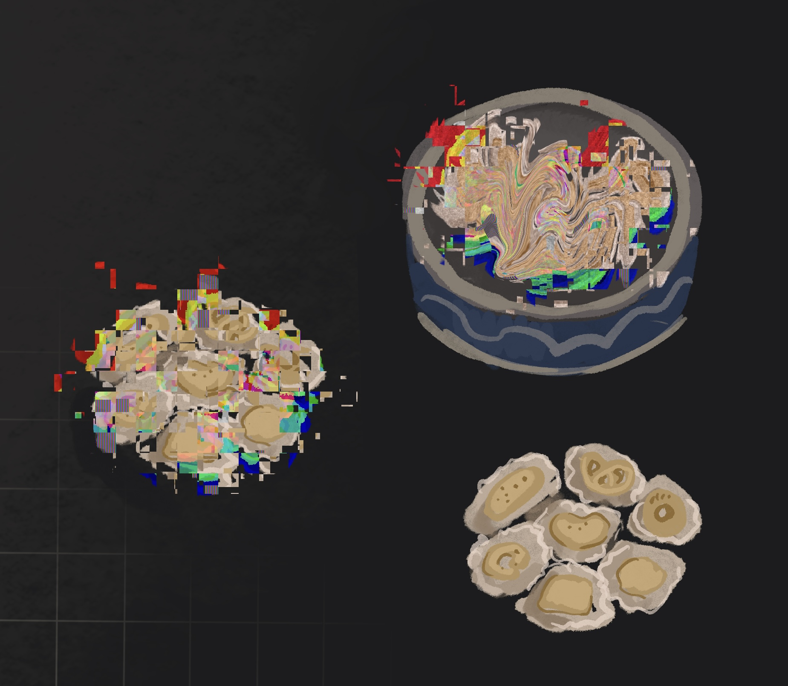

Quelques expériences sur *editor.p5js.org* avec la déformation de fragments d'image

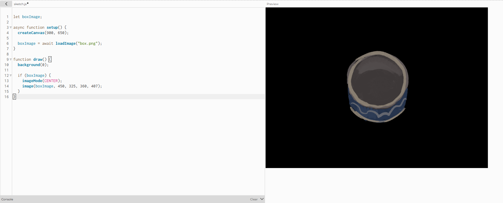
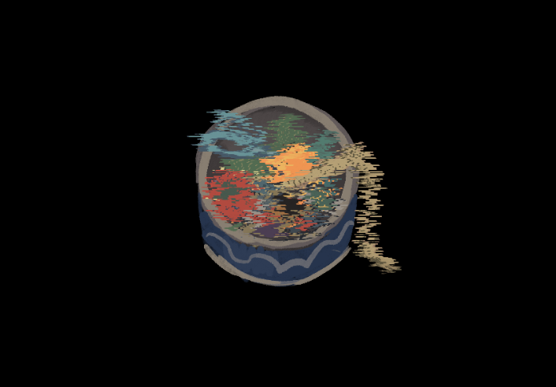
