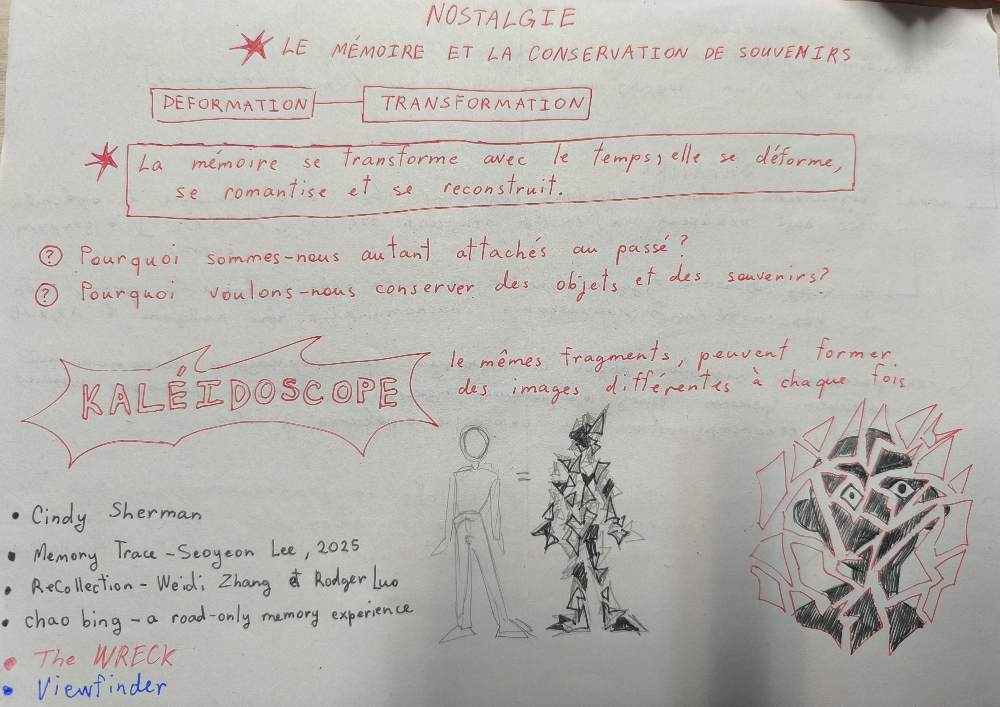
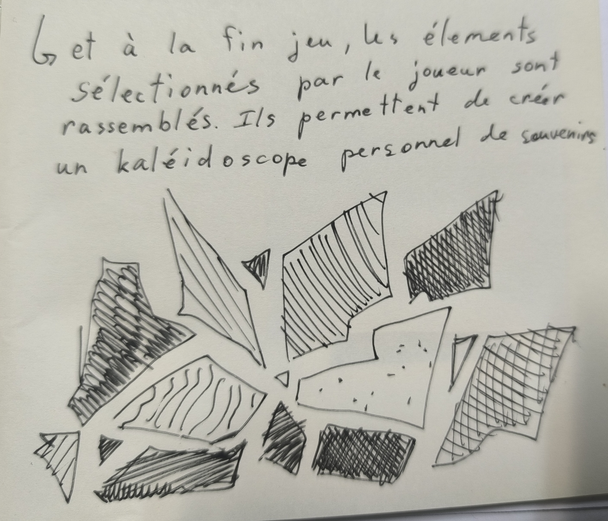

# DAD-NNN-Inesa

**inesa hakobyan**

# JOUR 1 — 23.11.2026

## Point de départ

*« Chaque fois que l'on se souvient d'un souvenir, on se souvient d'un souvenir. »*

### Réflexion initiale

Réflexion sur la manière dont les souvenirs sont altérés et sur les raisons de ces altérations.

**Biais cognitifs liés à la mémoire**

Contrairement à un enregistrement vidéo fidèle, nos souvenirs sont souvent altérés, réorganisés et reconstruits, parfois sans que nous en ayons conscience.

### Sujet personnel

Mon sujet personnel est la nostalgie et la distorsion / déformation des souvenirs.

Je souhaite explorer la manière dont notre mémoire transforme le passé, comment les souvenirs évoluent avec le temps et pourquoi notre perception de certains événements change.

## Première idée de projet

Le projet prendrait place dans un espace numérique en 2D ou en 3D, dans lequel le joueur pourrait se déplacer et interagir avec différents objets.

### Mécanique de recadrage

La fonction de recadrage permettrait de sauvegarder des fragments de l'environnement considérés comme importants, intéressants ou mémorables.

À l'intérieur du cadre, le fragment serait déformé. Cette légère distorsion serait conservée même après sa sauvegarde.

L'objectif final serait de constituer une collection de souvenirs déformés.

## Métaphore visuelle — Kaléidoscope

Les fragments se reflètent, se répètent et se multiplient de façon asymétrique.

Un objet ordinaire peut ainsi se métamorphoser en une composition totalement différente.

1
