# Référence

### Viewfinder
(https://store.steampowered.com/app/1382070/Viewfinder/?l=french)

Un jeu de puzzle à la première personne où le joueur utilise des photographies, des dessins et d'autres images pour manipuler le monde 3D environnant. Les images s'intègrent à l'espace et en modifient la géométrie.

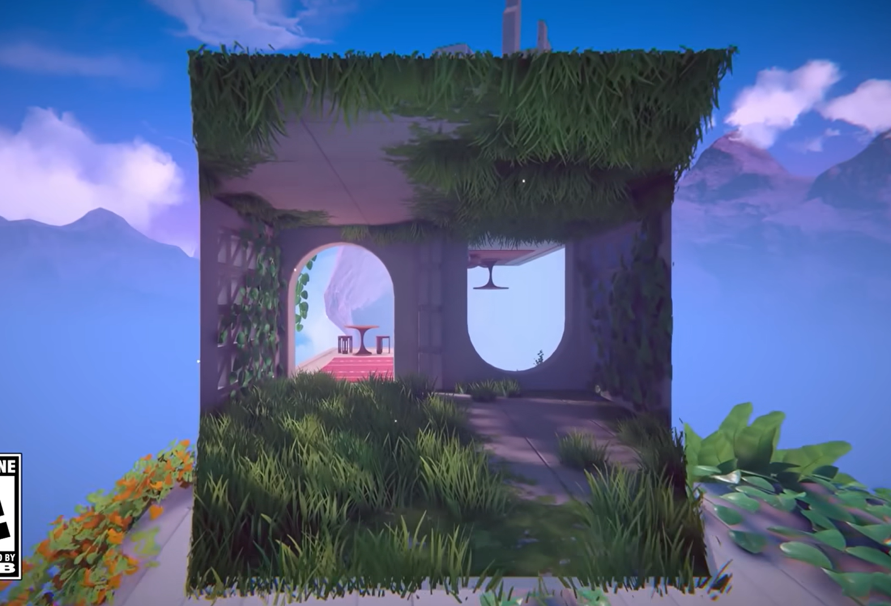
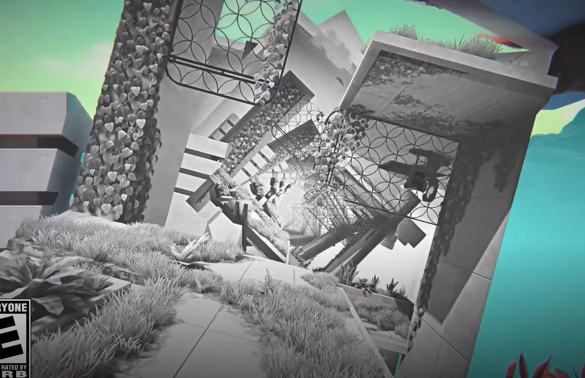
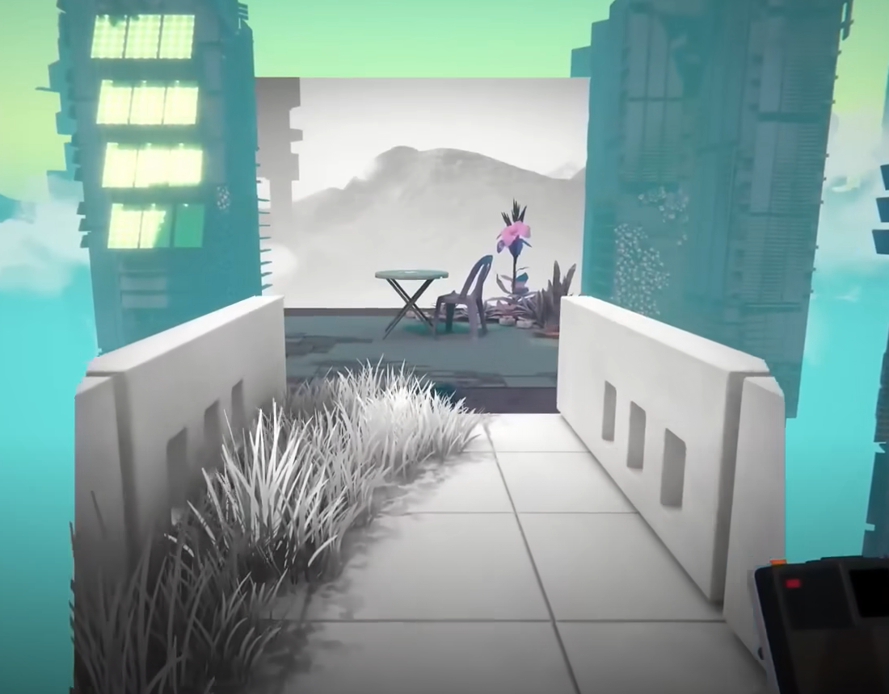

### The Wreck 
(https://store.steampowered.com/app/1687960/The_Wreck/?l=french)

Un roman visuel interactif en 3D racontant l'histoire d'une femme traversant une période difficile. À travers les souvenirs de l'héroïne, le joueur découvre progressivement son passé. Les scènes de souvenirs peuvent être rembobinées et explorées sous différents angles.

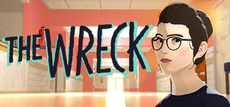
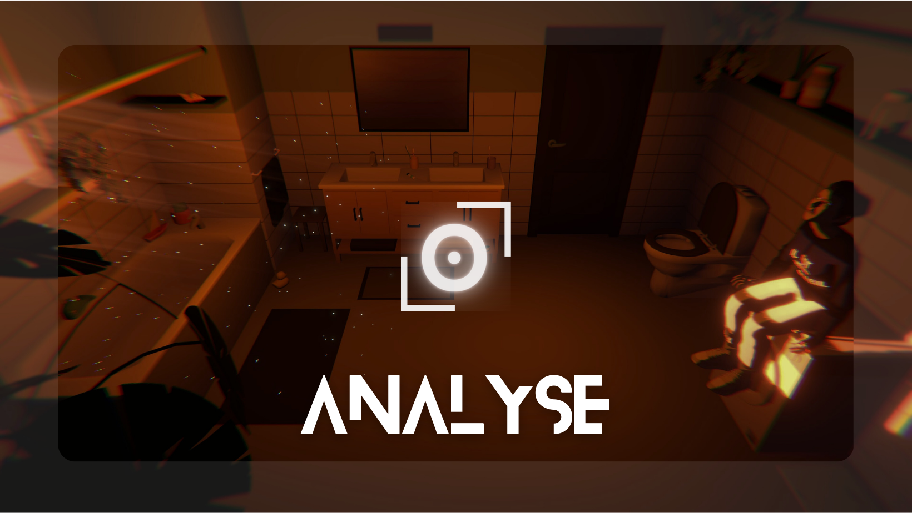
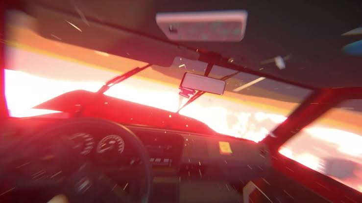

### TMemory of a broken dimension

(https://xra.itch.io/memory-of-a-broken-dimension)

Un jeu expérimental à la première personne dans lequel le joueur explore un étrange espace numérique composé d'objets fragmentés, de structures détruites et de bugs visuels.

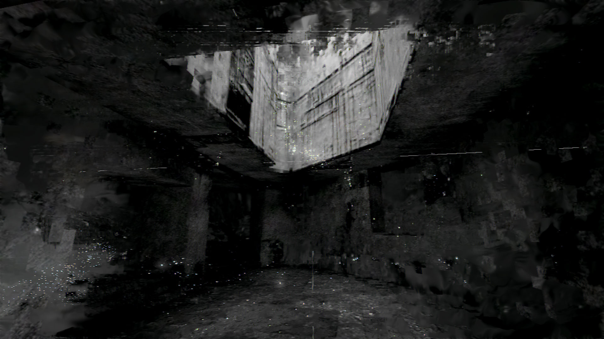
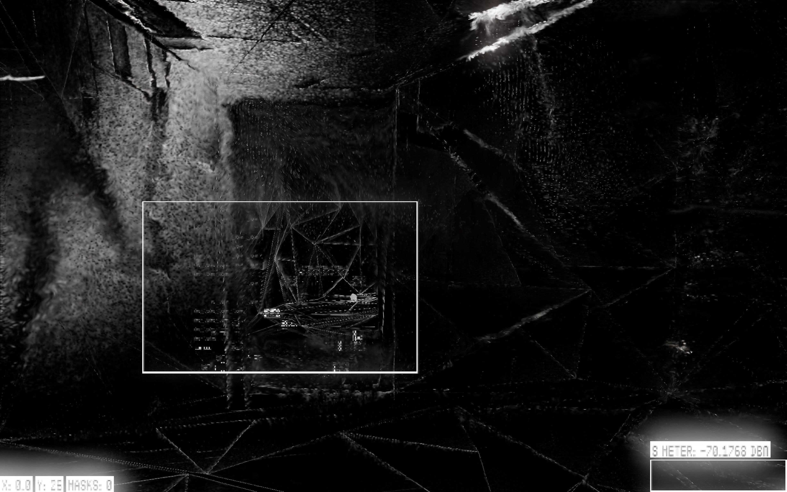
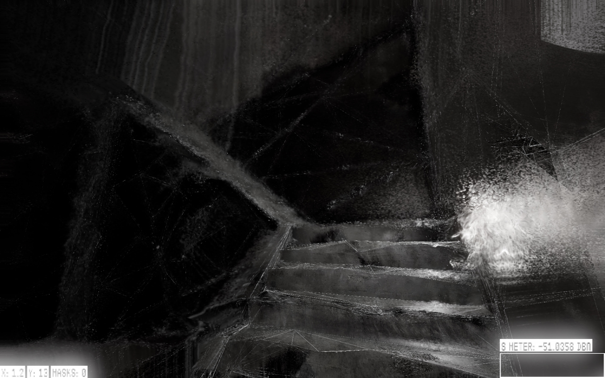

### The Roottrees are Dead

(https://store.steampowered.com/app/2754380/The_Roottrees_are_Dead/)

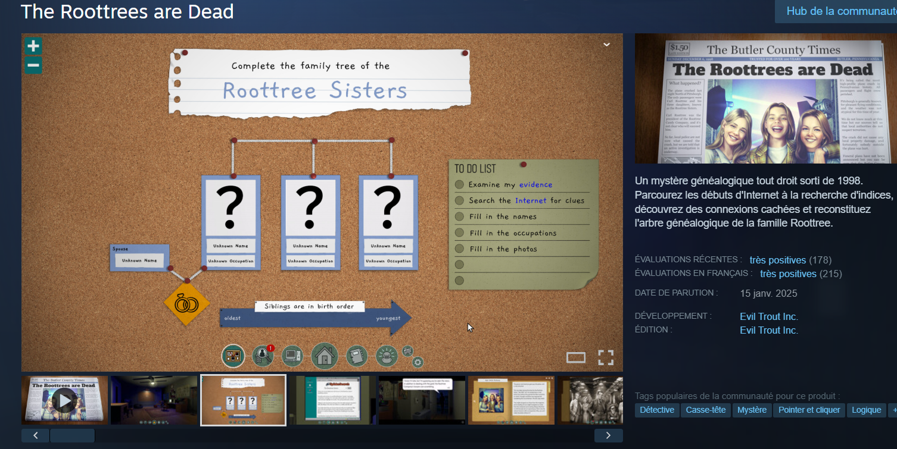

### Ever Seen A Cat?

(https://store.steampowered.com/app/1733060/Ever_Seen_A_Cat/?l=french)

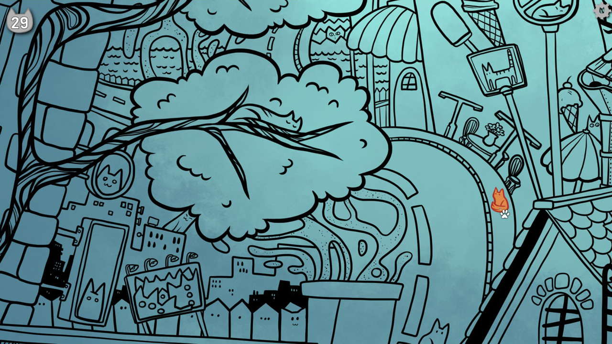
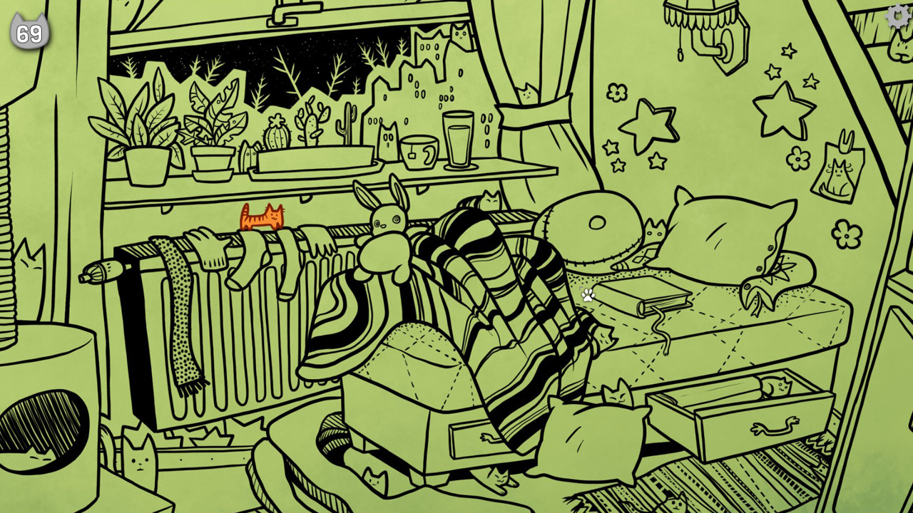

